# Темы для 1С:EDT

Плагин цветовых палитр интерфейса и редактора BSL для **1С:EDT 2026.1.2, 2026.1.3 и 2026.2.2**.
11 тёмных схем, личные цвета и настройка шрифта кода с предпросмотром.

Текущая версия — **0.1.16**.

## Возможности

- Палитры интерфейса поверх штатной Dark, подсветка BSL и QL/DCS в конструкторе запроса.
- Редактор 17 цветовых ролей: HEX, выбор цвета, образцы и сброс к значениям стиля.
- Отдельные личные варианты каждой схемы в текущей рабочей области.
- Выбор семейства и размера шрифта кода с предпросмотром.
- Применить / ОК / Отмена и восстановление исходных цветов и шрифта.
- Установка по URL сайта обновлений или из p2 ZIP с собственными bundle и feature.

## Палитры

Снимки сделаны в тестовой рабочей области EDT. Нажмите на миниатюру, чтобы открыть полный размер.

| Ayu Dark (Bordered) | Darcula | Dracula |
|---|---|---|
| [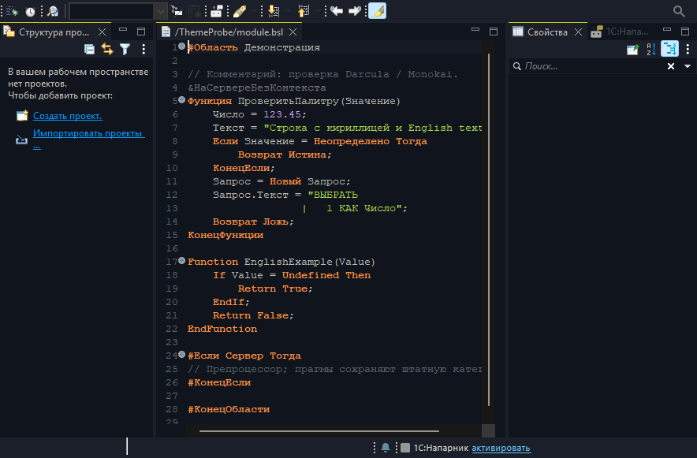](docs/screenshots/ayu-dark.png) | [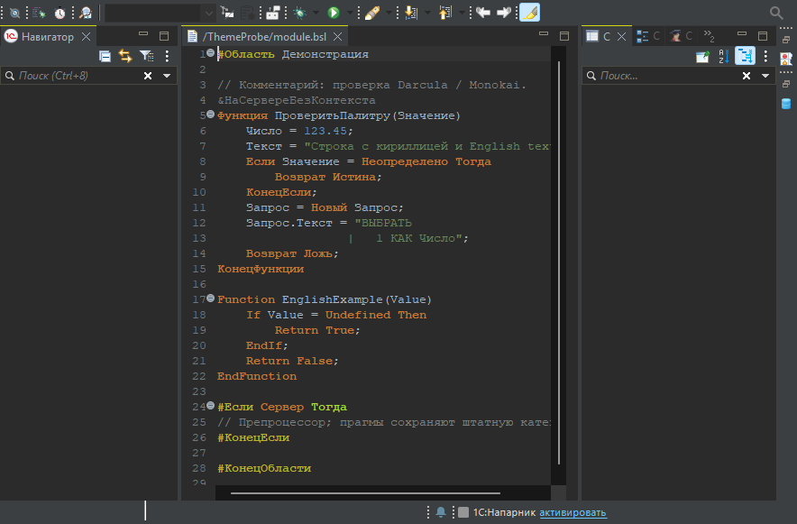](docs/testing/screenshots/darcula-workbench.png) | [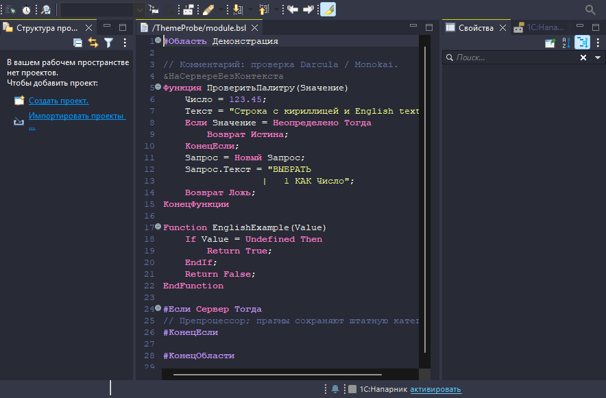](docs/screenshots/dracula.png) |
| **GitHub Dark Default** | **Monokai** | **Night Owl** |
| [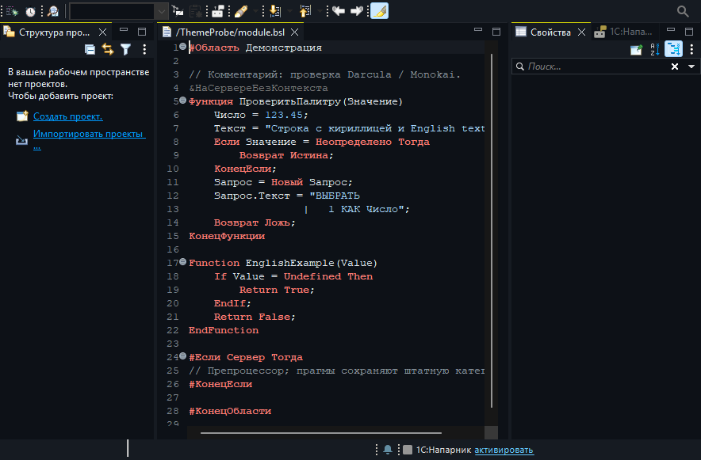](docs/screenshots/github-dark-default.png) | [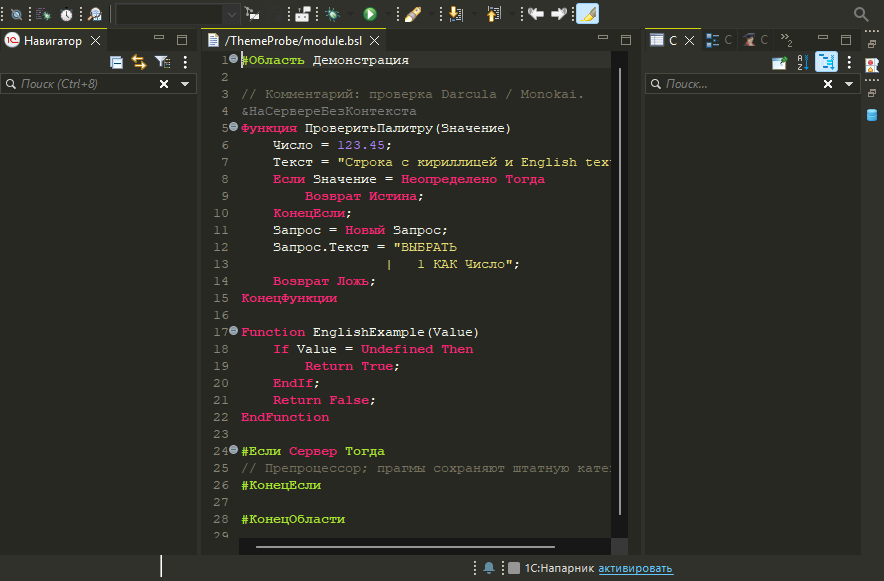](docs/testing/screenshots/monokai-restarted-workbench.png) | [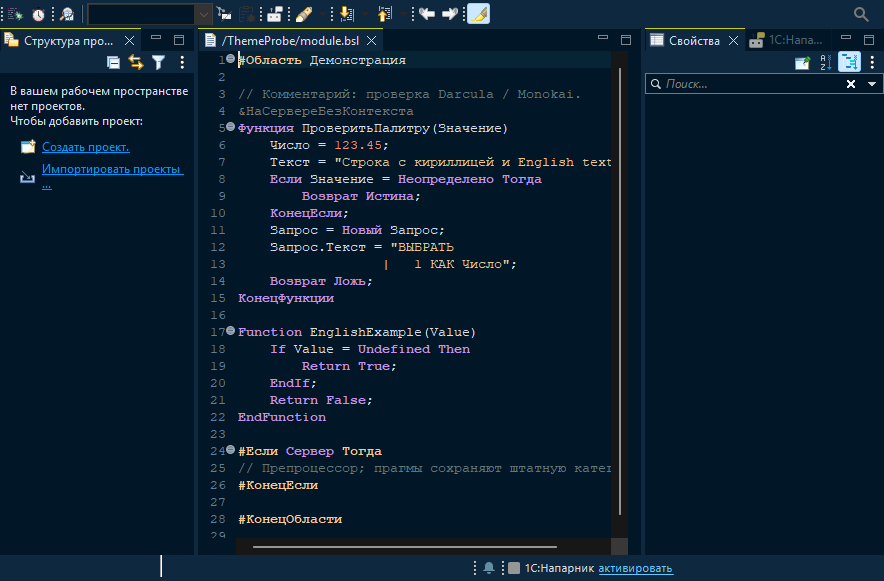](docs/screenshots/night-owl.png) |
| **Noctis Minimus** | **One Dark Pro** | **Shades of Purple** |
| [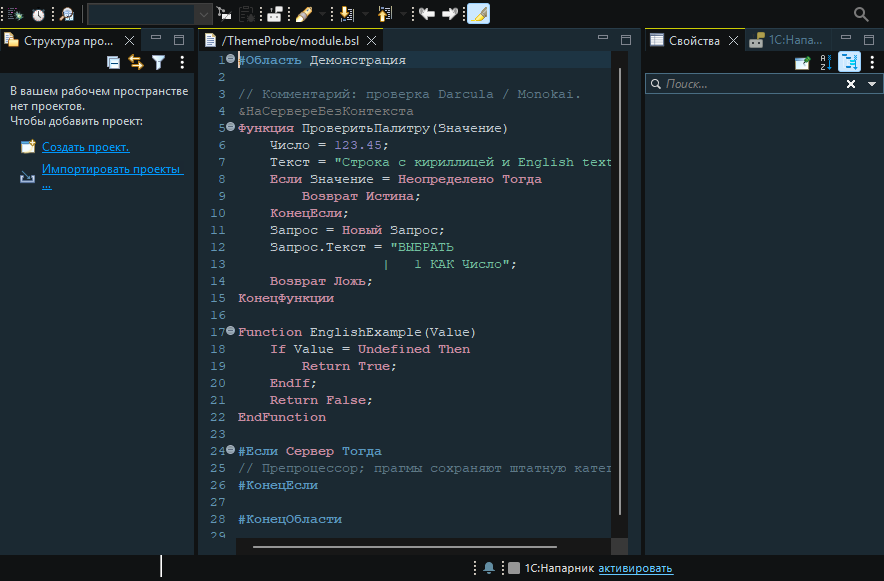](docs/screenshots/noctis-minimus.png) | [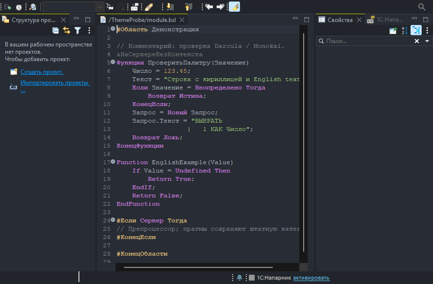](docs/screenshots/one-dark-pro.png) | [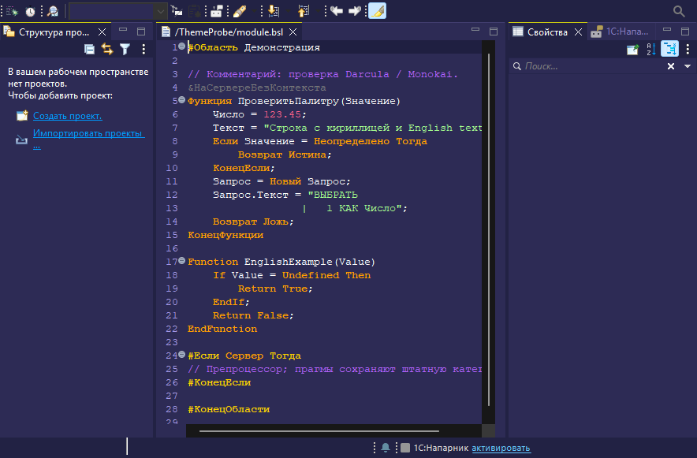](docs/screenshots/shades-of-purple.png) |
| **Visual Studio Dark (C/C++)** | **Winter is Coming (Dark Blue)** | |
| [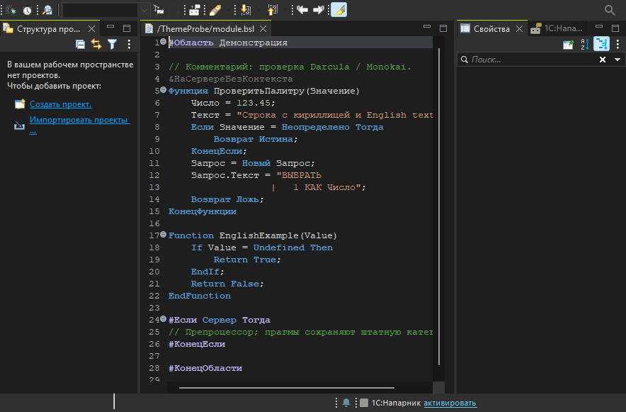](docs/screenshots/visual-studio-dark-cpp.png) | [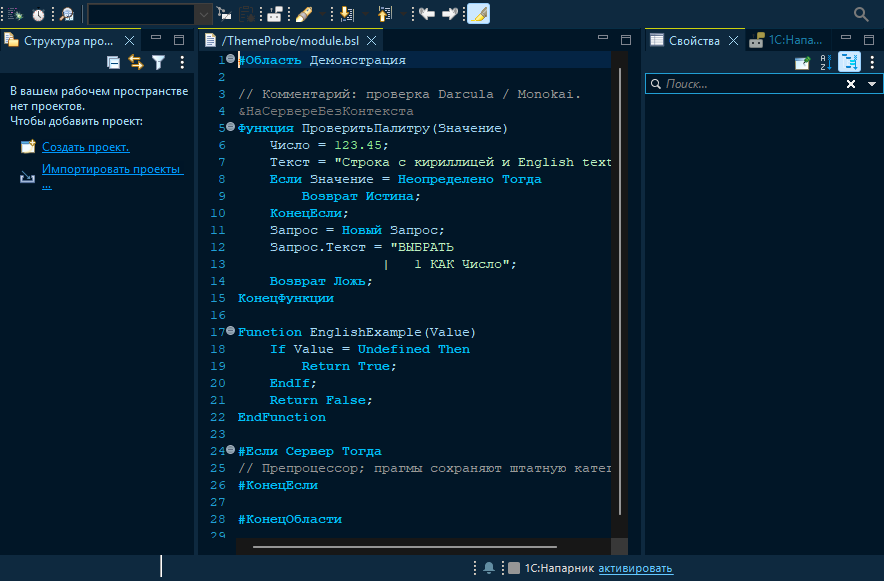](docs/screenshots/winter-is-coming-dark-blue.png) | |

Darcula и Dracula — разные схемы. Цвета адаптированы к ролям EDT;
это не полные копии исходных интерфейсов VS Code.

## Установка

1. Откройте **Справка → Установить новое ПО… → Добавить…**.
2. Укажите имя **Темы EDT** и адрес сайта обновлений:

   ```text
   https://litonchik.github.io/ones_edt_themes/repository/
   ```

   Выберите компонент **Темы EDT — цветовые палитры**.
3. Завершите установку и перезапустите EDT.
4. Откройте **Окно → Настройки → Внешний вид → Темы EDT**,
   выберите палитру и нажмите **Применить** или **ОК**.

Для следующих версий используйте **Справка → Проверить обновления**.

Для офлайн-установки скачайте `edt-themes-0.1.16.zip` и `.zip.sha256`
из [Releases](https://github.com/litonchik/ones_edt_themes/releases/latest),
затем выберите **Добавить… → Архив…**. ZIP из **Code → Download ZIP** содержит
исходники и не подходит для установки. Проверку SHA-256 описывает подробная инструкция.

[Подробная инструкция, обновление и удаление](docs/user-guide.md).

## Совместимость и ограничения

- Windows x64: EDT **2026.1.2+2 / 2026.1.3+25** с Java **17**; EDT **2026.2.2+21** с Java **25**.
- macOS x64: пользователь подтвердил 0.1.5 на EDT 2026.1.3; новые версии на Mac не проверялись. EDT 2025, неизвестные сборки и Linux не разрешены.
- Формы, макеты и другие исключённые содержательные области сохраняют штатное оформление.
- Настройки BSL на уровне проекта могут иметь приоритет над настройками рабочей области.
- После первого применения часть нативных контролов обновляется полностью после перезапуска.
- В тестовой EDT воспроизводится известная CSS-ошибка заголовка Properties;
  полная ручная матрица с рабочим metadata-проектом остаётся открытой.

Для 0.1.16 выполнены **79 unit tests**; результаты проверки трёх EDT, QL/DCS и семантических цветов:
[отчёт и границы проверки](docs/testing/edt-2026-compatibility-validation.md).

## Разработка

Unit tests модели можно запустить без установленной EDT, с JDK 17 и Maven:

```shell
mvn --batch-mode --no-transfer-progress -f tests/unit/pom.xml clean test
```

Полная сборка p2 требует установленной целевой EDT и проверенного Maven **3.9.11**:

```powershell
& ./scripts/build.ps1 -Action Verify `
    -MavenHome 'C:\apps\apache-maven-3.9.11' `
    -JavaHome 'C:\Program Files\Axiom\AxiomJDK-Pro-17-Full' `
    -EdtHome 'C:\Program Files\1C\1CE\components\1c-edt-2026.1.3+25-x86_64'
```

Укажите свои пути. Результат — `dist/edt-themes-0.1.16.zip` и SHA-256.
`dist`, `target`, `.work` и `.cache` исключены из Git.
GitHub Actions запускает unit tests модели и проверки упаковки сайта обновлений;
он не заменяет проверку EDT. Сайт обновлений публикуется из проверенного ZIP
последнего стабильного релиза, без повторной сборки плагина в CI.

[Участие в разработке](CONTRIBUTING.md) · [Документация](docs/README.md) ·
[История изменений](CHANGELOG.md) · [Подготовка релиза](docs/releasing.md)

## Лицензия

Собственный код проекта — [MIT](LICENSE).
Палитры сохраняют лицензии и авторство своих источников:
[атрибуция](THIRD_PARTY_NOTICES.md). Eclipse, EDT и другие зависимости платформы
не входят в поставку и сохраняют собственные условия использования.

Проект независимый; не является продуктом или официальным расширением фирмы «1С».
