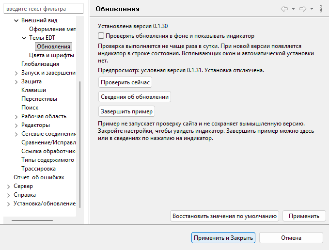

# Локальный предпросмотр индикатора обновлений — 0.1.30

Историческая локальная проверка. 09.11.2026 пользователь подтвердил работу;
по его запросу режим примера удалён из производственной версии.
Кнопка и инструкция ниже относятся только к локальной сборке от 06.11.2026.

Дата: 06.11.2026. Дополнение к [проверке индикатора](update-indicator-validation.md).
Commit/push/release не выполнялись; опубликованная версия остаётся 0.1.29.

Добавлена кнопка **Показать пример индикатора** на странице **Темы EDT → Обновления**.
Закрытие настроек не завершает пример; пользователь может осмотреть значок в рабочем
окне и открыть немодальные сведения. В них явно указан пример, установка и переход
к релизу отключены. Производственная версия больше не содержит эту функцию.

## Проверка

Maven/Tycho Verify, состав ZIP и **137 unit tests — PASS**.
Адресная UI-матрица нового поведения: **129 PASS, 0 FAIL**.

| Windows EDT | Java | Предпросмотр |
|---|---|---:|
| 2026.1.3 | 17 | 43 PASS |
| 2026.1.2 | 17 | 43 PASS |
| 2026.2.2 | 25 | 43 PASS |

Точные сборки: 2026.1.3+25, 2026.1.2+2, 2026.2.2+21.
На всех трёх EDT проверены:

- полная видимая область значка, явная пометка примера в tooltip;
- отсутствие нового окна и сохранение фокуса редактора при появлении значка;
- работа с выключенной фоновой проверкой, ноль вызовов тестового источника;
- неизменность реального State, всех updates preferences, cached release и timestamp;
- немодальные сведения только по нажатию; обе внешние кнопки отключены;
- защита и от программной Selection, и от прямого вызова UpdateInstaller;
- ноль вызовов штатной команды и неизменность регистрации/enable-флагов p2-сайта;
- запуск/завершение через настройки, сохранение примера после Cancel, Apply и OK;
- явное отключение включённого флага завершает пример, неизменный флаг его сохраняет;
- наложение примера на настоящий cached update и точный возврат к нему;
- ручная проверка завершает пример, её реальный ответ сохраняется независимо от примера;
- Apply без изменения флага не отменяет реальный активный запрос;
- stop/start убирает пример и восстанавливает только настоящий кэш;
- пустой журнал оформления после проверки.

Реальный endpoint и сеть не менялись. Ранее пройденные 309 runtime PASS не
объявляются повторно выполненными на этой сборке; здесь выполнена адресная матрица
предпросмотра и затронутого setEnabled. Изменены пять исходных классов:
UpdateNotifications, UpdateInstaller, ShowUpdateDetailsHandler, UpdateDetails,
UpdatesPreferencePage. В ZIP изменены семь class-файлов, включая два вложенных Job.
Остальные 65 class-файлов, plugin.xml, все ресурсы и лицензии
побайтово прежние. Java class major 61; тестовые классы отсутствуют в поставке.
Все 19 палитр и ZIP 0.1.16–0.1.29 сохранили контрольные SHA-256.
Mac и физическая смена DPI отдельно не проверялись.

## Поставка и очистка

Bundle: `0.1.30.202611061225`. ZIP: `dist/edt-themes-0.1.30.zip`.
SHA-256: `7459542046c1457017de81b18f5432d35e2106f36e099ec4ba97d3b62d0c8451`.

Все три установленных bundle перед удалением побайтово совпали с ZIP.
Отдельные Cleanup → Reconcile → Uninstall → Audit — PASS. Монитор остановлен,
тестовые updates keys удалены; bundle и probe отсутствуют. Базовые inventories
1267 / 1257 / 1234 сохранены. Четыре временных junction удалены с проверкой путей
и сохранности целевых каталогов. Рабочая EDT и её workspace не менялись.

[Матрица и хеши](2026-11-06-update-preview/runtime-matrix.json),
[сборка](2026-11-06-update-preview/build-summary.txt),
[очистка](2026-11-06-update-preview/cleanup-summary.json),
[снимки](2026-11-06-update-preview/screenshots.json).

